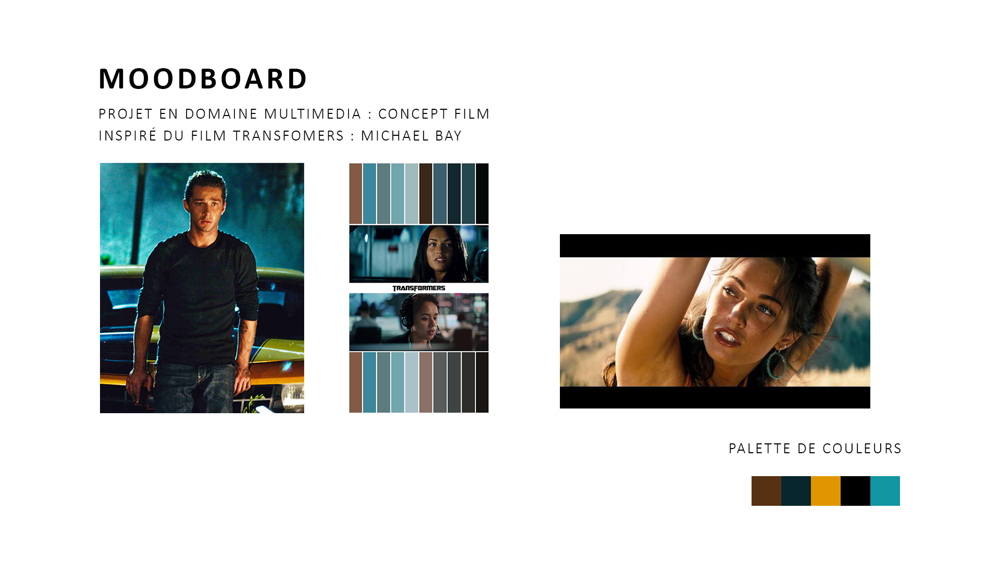

# Transformers : Code Name D.U.M.B

Projet conçu en équipe avec : Lukas et Felipe 

## Le concept et l'audience

- Une phrase (logline) : Un chasseur de primes criblé de dettes 
- Le public cible : Adolescence/ Adulte
- La franchise d'origine : Transformers

## L'intrigue

- Le début : On suit un chasseur de primes qui accompli ces primes à l'aide de l'intelligence artificielle, donc au départ il reçoit   une mission de la part de son supérieur. Il confie tout à son assistant virtuel que se soit les détails de sa mission jusqu'à les détails de sa vie. 
  
- Le milieu : La mission part vite dans tout les sens des Transformers sont impliqués, notre chasseur de prime se retrouve dépasser par les événements et dans le feu de l'action il ne remarque pas que son téléphone est maintenant en contrôle d'un Transformer.
  
- Le revirement (plot twist) : Lors d'un discussion l'IA comprend qu'elle a une personne pas très intelligente et décider de   l'éliminer et de s'y prendre à sa famille. (Le téléphone se transforme)
  
- La fin : Après avoir été vaincu par son assistant il décide d'arrêter son utilisation de toute forme d'intelligence artificiel 
  
## Le personnage principal

- Description (physique et psychologique) : Père de famille, homme de taille moyenne, Athlétique, vêtu de noir, lunette de soleil
  Homme décontracté, distrait, stupide 
- Son désir (ce qu'il veut) : Il désire juste réaliser ses missions afin de pouvoir nourrir sa famille
- Son besoin (ce qu'il lui faut) : Il lui faut donc de l'argent à la fin de la journée 
- Son évolution : Au départ il est dépendant de son assistant virtuel pour ses tâches quotidiens et sa job puis au fur et à mesure du récit il commence a comprendre que l'IA n'est pas nécessaire pour chaque moment de sa vie.

## L'univers

- Où et quand se passe l'histoire : L'histoire ce passe au centre de Montréal 
- Un élément de folklore qui rend l'univers vivant : L'existence des Decepticons

## La direction cinématographique

- La palette de couleurs : orange, bleu, bleu-clair, noir, brun (jeu de couleur froide et chaude & contraste orange/bleu) 
- L'éclairage : Lumière extérieur ( Golden Hour ), éclairage dynamique
- Le rythme du montage : frénétique, discontinu, chaos (coupes ultra-rapides), usage intensif de ralenti(combat)
- Un moodboard (3 à 5 images de référence) : 

